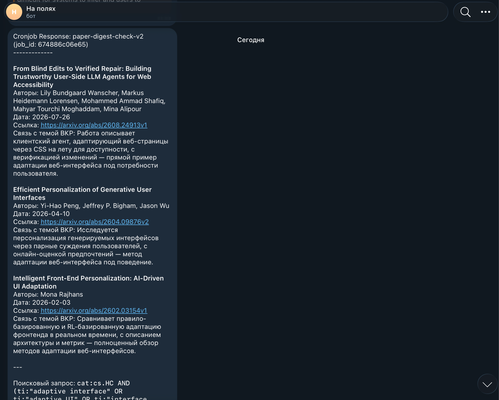

# P2. Поиск публикаций arXiv

Для регулярного поиска статей по адаптации веб-интерфейсов разработан навык `paper-digest`. Он вызывается по просьбе найти новые статьи по теме ВКР или выполнить `paper-digest`.

Тема берётся из `MEMORY.md`. Модель составляет запрос arXiv, программа получает публикации, затем модель отбирает их по аннотациям. Python сверяет ссылки и цитаты с ответом API и собирает сообщение максимум из трёх статей. Если записей нет или источник недоступен, бот сообщает об этом.

Расписание ежедневно запускает тот же сценарий в 09:00.

[Текст навыка: SKILL.md](../skills/paper-digest/SKILL.md).

## Результат

17 ноября выполнены три запуска по расписанию с поиском за последние 365 суток. Все три подборки доставлены в Telegram. Условия: VPS из общего отчёта, Nemotron 3 Ultra free. Измерения получены при проверке ранних версий навыка; время взято из журнала cron.

| Начало 17 ноября, МСК | Время, с | Входные / выходные токены | Записей в ответе | Результат проверки |
|---|---:|---:|---:|---|
| 11:26:57 | 13,980 | 17 949 / 1 026 | 3 | Среди выбранных работ есть статья о смешанной реальности, выходящая за тему веб-интерфейсов |
| 11:32:57 | 8,906 | 17 291 / 767 | 3 | Подборка доставлена; её показывает скриншот ниже |
| 22:39:57 | 32,089 | 17 378 / 1 187 | 6 | Бот прислал шесть записей вместо заданных трёх |

В ответах бот привёл названия, авторов, ссылки и пояснения о связи статей с темой.

Полные ответы: [первый запуск](evidence/runs.md#прогон-4), [второй](evidence/runs.md#прогон-5), [третий](evidence/runs.md#прогон-7).

## Расходы

Месячный расход рассчитан по среднему числу токенов этих трёх запусков при одном запуске в день. Это прогноз: объём выдачи и число действий модели могут меняться.

| Показатель | Три измеренных запуска | 30 запусков за месяц |
|---|---:|---:|
| Входные токены | 52 618 | 526 180 |
| Выходные токены | 2 980 | 29 800 |
| Стоимость запросов к бесплатной модели | $0 | $0 |

| Условия и остальные расходы | Значение |
|---|---:|
| Цена миллиона входных токенов | $0 |
| Цена миллиона выходных токенов | $0 |
| Аренда VPS за месяц | €5,93 |
| Фактические расходы OpenRouter за проверки 17 ноября | $0 |

Диалоги с ботом и повторные попытки также расходуют суточную квоту бесплатных запросов.