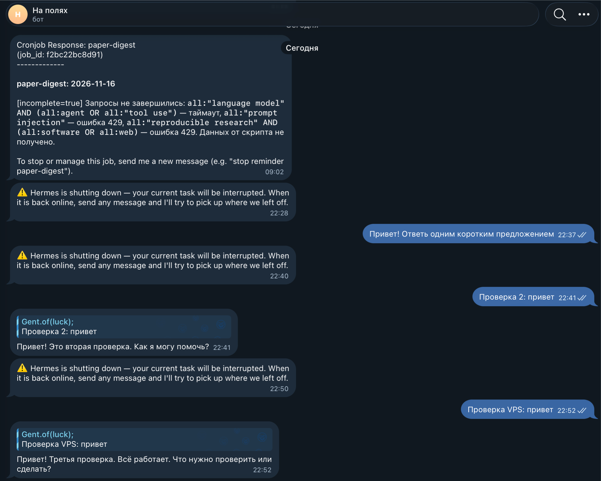

# Задание 2. Агент для исследовательских задач

[T1: сравнение платформ](T1.md)
[P2: навык](P2.md)

## Развёртывание

Hermes развёрнут в Docker на отдельном VPS.
Для агента выделен пользователь `agent`, настроены вход по SSH-ключу и firewall, вход по паролю отключён. Пакеты сервера обновлены.

| Параметр | Значение |
|---|---|
| Провайдер, тариф, регион | AEZA, CLTs-1, США |
| Стоимость VPS | €5,93 в месяц |
| ОС и ресурсы | Ubuntu 26.04.1 LTS; 1 vCPU, 2 ГБ RAM, 30 ГБ NVMe |
| Docker / Compose | 29.9.3 / 5.7.1; запуск `hello-world` проверен |
| Hermes | 0.23.0 |
| Провайдер и модель | OpenRouter, `nvidia/nemotron-3-ultra-550b-a55b:free` |
| Контекст модели | 1 000 000 токенов |
| Лимиты ключа | $50 без автоматического сброса; 50 бесплатных запросов в сутки |

Настройки запуска находятся в [compose.yaml](../compose.yaml).

`hermes setup` запускался в контейнере, в который каталог `data/` смонтирован как `/opt/data`.
Каталог `skills/paper-digest/` смонтирован в контейнер только для чтения.
[Журнал старта](evidence/checks.md#запуск) подтверждает наличие встроенных навыков и подключение Telegram.

## Проверки бота и памяти

Бот (https://t.me/gentofluck_margin_bot) ответил на сообщение владельца.
Время измерено по [журналу шлюза](evidence/checks.md#ответ-бота).

| Проверка | Обработка в Hermes, с |
|---|---:|
| «Проверка VPS: привет» | 1,0 |

Доступ разрешён одному Telegram ID. Со второго аккаунта ответа не было, в журнале появилась запись `Blocked unauthorized user`.

В [USER.md](../memory/USER.md) заданы язык и формат ответов, в [MEMORY.md](../memory/MEMORY.md) тема и критерии исследования. На вопрос о выбранных критериях без подсказки агент назвал время выполнения задачи, число ошибок пользователя и понятность интерфейса. [Результат проверки](evidence/checks.md#память).

## Инструменты и журналы

Для поиска источников используется arXiv API: агент составляет запрос и отбирает найденные статьи по аннотациям.

Агент прочитал HTML-страницу arXiv и выполнил команды. Инструменты работы с файлами проверены записью и последующим чтением временного файла.

Для проверки планировщика поставил поиск статей на расписание. Результаты автономных запусков приведены в [P2](P2.md).

Логи Docker ограничены пятью файлами по 10 МБ.
Для `agent.log` задан размер 5 МБ и три резервных файла.
[Logrotate](../deploy/hermes-logrotate) ежедневно ротирует журналы,
[таймер](../deploy/hermes-log-retention.timer) удаляет архивы старше семи суток.

## Отладка

### Подключение к Telegram

При запуске шлюза появилось сообщение `telegram connect timed out after 30s`. Проверил, не связана ли ошибка с неверным токеном: отправил запрос к методу `getMe` Telegram Bot API. В ответ получил данные бота, поэтому ошибку в токене исключил. После перезапуска шлюз подключился к Telegram.

### Лимит шагов модели

Один из запусков завершился сообщением `Iteration budget exhausted`: агент исчерпал разрешённое число шагов, не подготовив ответ. По журналу проверил, на что ушли эти шаги: модель повторяла поисковые запросы и вызовы инструментов. Вместо свободного выбора следующих действий задал последовательность: модель составляет запрос, программа получает статьи из arXiv, затем модель отбирает подходящие работы. Проверку ссылок и оформление текста выполняет программа.

### Суточная квота OpenRouter

Запуск завершился ошибкой `HTTP 429: Rate limit exceeded: free-models-per-day`. Для мониторинга настроил один запуск в сутки.
Также при исчерпании квоты бот теперь сообщает об ошибке, а не формирует подборку без данных.

## Применение ИИ

Codex помогал с промптами, Python-клиентом. Результаты проверялись запросами к arXiv, журналами и сообщениями бота. Ссылки сверялись с API, соответствие теме оценивалось по аннотациям.

## Вывод

Автономному агенту можно поручать повторяющиеся задачи (как поиск новых публикаций).

В работе модель иногда выбирала неподходящие статьи и не завершала задачу. Поэтому интерпретацию данных и окончательные научные выводы не стоит полностью передавать агенту: он может пропустить существенные условия или сделать утверждение, которое не подтверждается источником. Также для регулярных запусков нужны журналы, сообщения об отказах и контроль лимитов.
