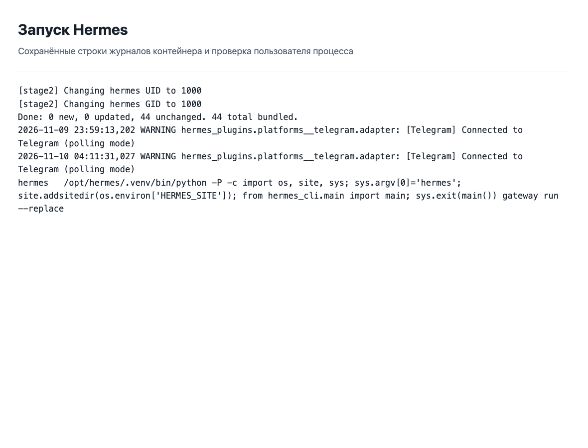
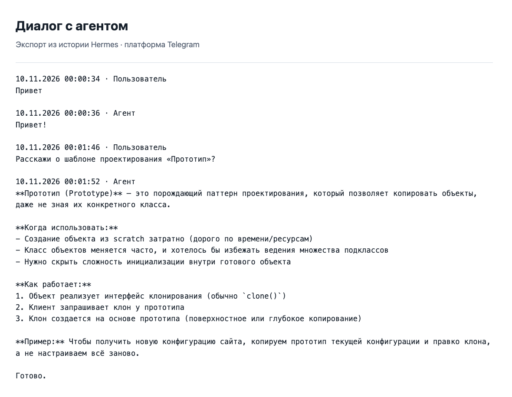
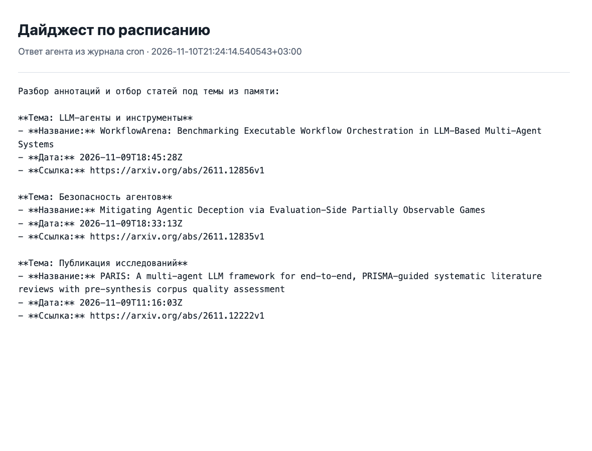

# Задание 2. Агент для исследовательских задач

[Репозиторий](https://github.com/Gentofluck/hermes-research-agent) · [Бот «На полях»](https://t.me/gentofluck_margin_bot) · [T1: сравнение платформ](T1.md)

Выбрал T1 и P2. Для сравнения взял Hermes, OpenClaw, PicoClaw и свой Jarvis. Практическая часть — навык, который получает новые статьи arXiv и составляет дайджест в Telegram.

## Развёртывание

Для работы использовал VPS AEZA. VLESS, который работал на нём раньше, отключил; копию конфигурации сохранил отдельно от проекта. Установил обновления Ubuntu, Docker и Compose, проверил `hello-world` и перезагрузил сервер.

| Параметр | Значение |
|---|---|
| Провайдер, тариф, регион | AEZA, CLTs-1, США |
| Стоимость VPS | €5,93 в месяц |
| ОС | Ubuntu 26.04 LTS |
| CPU, RAM, диск | 1 CPU, 2 ГБ, 30 ГБ NVMe |
| Docker Engine / Compose | 29.9.3 / 5.7.0 |
| Размер образа по Docker inspect | 4 558 319 042 байта |
| Настроенный лимит RAM контейнера | 1200 MiB |
| Модель | `nvidia/nemotron-3.5-lightning:free`, OpenRouter |
| Контекст по каталогу провайдера | 1 000 000 токенов |
| Лимит ключа OpenRouter | $50, без автоматического сброса |

Создал пользователя `agent`, проверил вход по ключу и отключил парольный вход. Firewall оставляет открытым SSH. Процесс агента работает с UID пользователя `agent`; Docker socket и папки других проектов в контейнер не передаются.

В [Compose](../compose.yaml) закреплён digest образа. Мастер настройки и шлюз используют один каталог данных, подключённый как `/opt/data`. Ключи хранятся в этом каталоге вне Git. Для Telegram разрешён только мой ID. Строки запуска и проверка пользователя процесса сохранены в [startup.txt](evidence/startup.txt).

Логи Docker ограничены пятью файлами по 10 МБ. Для файловых журналов настроены [ротация](../deploy/hermes-logrotate) и удаление архивов старше семи дней. Конфигурация таймера хранится в [deploy](../deploy/hermes-log-cleanup.timer).

## Проверки

В [USER.md](../seed/memories/USER.md) заданы язык, формат общения и кодовое слово. Проверочный вопрос не содержал самого слова; агент вернул значение из памяти. В отдельной проверке он создал и прочитал файл, нашёл документацию Hermes через веб-поиск и прочитал страницу.

Диалог через Telegram тоже прошёл. Ниже показан экспорт истории агента; исходные сообщения находятся в [telegram-dialogue.json](evidence/telegram-dialogue.json).

Время ответа рассчитано по меткам сообщений в истории Hermes, от сохранения входящего сообщения до сохранения ответа. Задержка доставки в клиент Telegram отдельно не измерялась.

| Сообщение | Время, с |
|---|---:|
| Привет | 2.370 |
| Расскажи о шаблоне проектирования «Прототип»? | 6.267 |

Проверка с настоящего постороннего Telegram-аккаунта пока не выполнена. Настройка списка доступа сама по себе её не заменяет.

## P2. Дайджест статей

[Навык paper-digest](../seed/skills/research/paper-digest/SKILL.md) использует темы и запросы из памяти. Подготовленный Python-скрипт получает статьи через arXiv API, оставляет публикации за неделю, убирает дубликаты и сохраняет исходный ответ. Модель читает аннотации, выбирает подходящие статьи и возвращает названия, даты, ссылки и метки тем.

В заданиях cron инструменты модели отключены. Сбор выполняет заранее подготовленный скрипт, а сохранение ответа и отправку в Telegram — шлюз. Это убрало повторные поиски и попытки запускать команды без пользователя.

Предусмотрены пустая выдача, ошибка XML, недоступность источника и ограничение запросов. Временные ошибки повторяются один раз. Исходные данные проверяются штатным сканером Hermes: исключённые записи остаются в исходном файле, а результат отмечается как неполный.

Три контрольных запуска выполнены 10 ноября 2026 года самим планировщиком. Тестовое расписание — `every 1m`; фактическое время запуска зависит от шага проверки планировщика. Показанные длительности включают получение статей, запрос к модели и доставку ответа. Входные токены включают кэшированные. Стоимость рассчитана по бесплатному тарифу выбранной модели.

| Прогон | Старт, МСК | Время, с | Получено / выбрано | Вызовы LLM | Токены вход / выход | Стоимость, $ |
|---|---|---:|---:|---:|---:|---:|
| [1](evidence/run-1.md) | 21:20:14 | 13.166 | 16 / 3 | 1 | 10 444 / 258 | 0 |
| [2](evidence/run-2.md) | 21:22:14 | 11.162 | 16 / 3 | 1 | 10 444 / 308 | 0 |
| [3](evidence/run-3.md) | 21:24:14 | 11.163 | 16 / 3 | 1 | 10 443 / 299 | 0 |

Во всех этих запусках выбранные ссылки найдены в ответе API и открывались с HTTP 200. Результаты всех попыток, включая ранние неудачные, сохранены в [measurements.json](evidence/measurements.json); отдельная проверка адресов — в [links.json](evidence/links.json).

После проверки тестовые задания завершены или удалены. Постоянное задание запускается ежедневно в 09:00 по Москве. Эти короткие повторные прогоны проверяют выполнение и доставку, а не доказывают качество отбора на большой выборке.

## Что изменил после первых запусков

Изначально агент сам искал файлы памяти, выполнял запросы и записывал дополнительные файлы. На это уходили шаги, а часть команд блокировалась в cron. Получение данных перенёс в скрипт, путь к памяти указал явно, инструменты модели для расписания отключил.

Окно поиска увеличил: после выходных прежнее окно отбрасывало последние публикации. Длинный пересказ результатов заменил короткими метками тем. Модель всё равно иногда добавляет лишний вводный текст и спорно относит статьи к темам, поэтому её ответ требует просмотра.

## Отладка

### OpenRouter отклонил запрос

Ошибка: `HTTP 402: This request requires more credits, or fewer max_tokens`. В запросе Hermes резервировал большой объём ответа; короткий прямой запрос проходил. Лимит ключа не означал наличие денег на счёте. Для дальнейшей работы переключился на бесплатную модель и проверил её на памяти, файлах и дайджесте.

### Запись попала в каталог программы

Ошибка: `Write denied: '/opt/hermes/tool-check.txt' is outside HERMES_WRITE_SAFE_ROOT (/opt/data)`. Относительный путь разрешался от каталога программы. Задал рабочий каталог в Compose и в задании cron. Повторная проверка создала и прочитала файл в `/opt/data/workspace`.

### Планировщик завершился без дайджеста

Ответ: `I reached the iteration limit and couldn't generate a summary`. По журналу агент искал память по неверному пути, повторял запросы и пытался выполнить заблокированную команду `python -c`. Проверил последовательность вызовов, затем перенёс сбор в подготовленный скрипт. После этого для отбора стал достаточен один вызов модели.

### Фильтр остановил исследовательский текст

Ошибка: `Blocked: prompt matches threat pattern 'prompt_injection'`. В полученной статье была цитата инструкции для атаки на модель. Повторная проверка записи тем же сканером подтвердила причину. Фильтр оставил включённым: такие записи исключаются из входа модели, а дайджест помечается как неполный. Это ограничивает полноту мониторинга статей по безопасности.

## Расходы

Оценка ниже использует среднее число токенов контрольных запусков и условный месяц из 30 дней. При неизменном бесплатном тарифе стоимость LLM нулевая, но доступность и лимиты провайдера могут меняться. VPS оплачивается независимо от числа запросов.

| Запусков в день | За месяц | Токенов за месяц | LLM, $ | VPS за месяц |
|---|---:|---:|---:|---:|
| 1 | 30 | 321 960 | 0 | €5,93 |
| 5 | 150 | 1 609 800 | 0 | €5,93 |
| 10 | 300 | 3 219 600 | 0 | €5,93 |

До перехода на бесплатную модель был выполнен короткий проверочный запрос Gemini. API вернул следующую оценку:

| Проверка | Вход / выход | Стоимость по API, $ |
|---|---:|---:|
| Gemini, ответ `OK` | 6 / 1 | 0,0000043 |
| Три контрольных дайджеста на free | См. таблицу прогонов | 0 |

## Применение ИИ

Claude использовался при первоначальной подготовке конфигурации и черновика навыка. С помощью Codex настроен сервер, переработаны сборщик, навык и отчёт, проверена документация платформ. Результаты проверялись командами SSH и Docker, журналами, историей сообщений, исходными ответами arXiv и HTTP-проверкой ссылок. Качество формулировок и тематического отбора оценивалось отдельно от успешного завершения задания.

## Вывод

Агенту можно поручить регулярный сбор открытых источников и подготовку списка для чтения. Ссылки и полезность статей нужно проверять по оригиналам. Публикацию научных выводов, передачу закрытых материалов внешней модели и изменения рабочих систем я бы оставил человеку: ошибка здесь затрагивает уже не только текст дайджеста.

## Источники

[Hermes в Docker](https://hermes-agent.nousresearch.com/docs/user-guide/docker), [планировщик Hermes](https://hermes-agent.nousresearch.com/docs/user-guide/features/cron), [модель OpenRouter](https://openrouter.ai/nvidia/nemotron-3.5-lightning:free), [лимиты OpenRouter](https://openrouter.ai/docs/api_reference/limits), [arXiv API](https://info.arxiv.org/help/api/user-manual.html).
